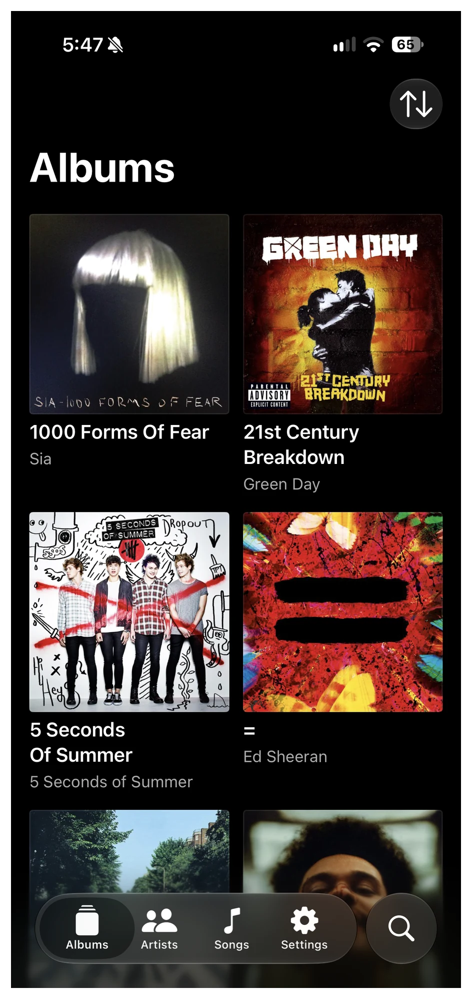
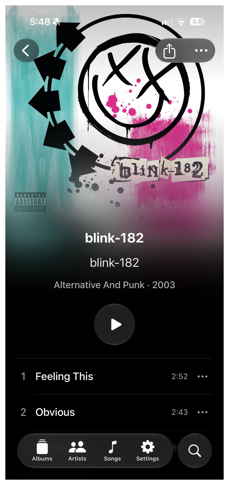
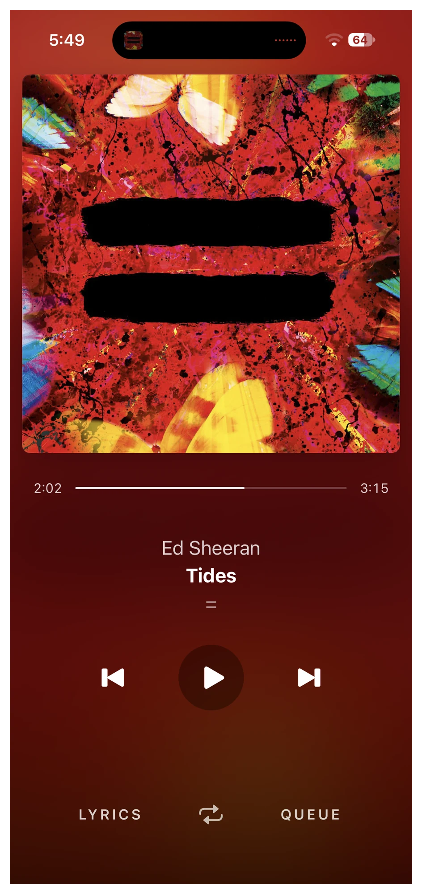
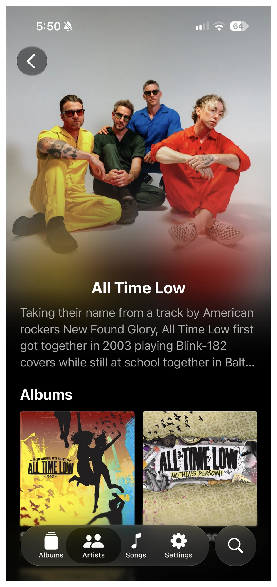
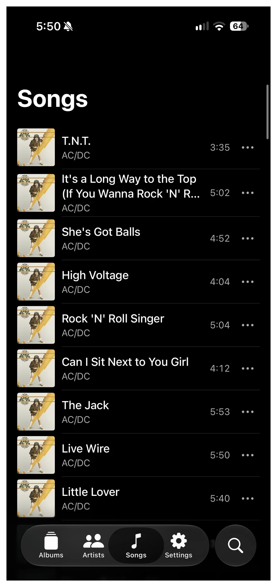

# Gevun

A music player for your Navidrome library on iPhone and iPad.

## Screenshots

  
  
  
  
  

## Features

- Browse albums, artists, and songs, or search your library.
- Listen in original quality with background playback and lock-screen controls.
- Follow synced lyrics and tap a line to jump to it.
- Add songs to your queue, play next, and repeat tracks or albums.
- Read artist biographies and discover similar artists.
- Switch between multiple Navidrome servers.
- A dark interface with colors drawn from your album artwork.

## Install

Requires **iOS 27 or later** and a Navidrome server.

Download [Gevun.ipa](https://github.com/DjangoCustard225/Gevun/releases/latest/download/Gevun.ipa). The IPA is unsigned; sign it with your sideloading tool before installing.

Open Gevun and sign in with your server address, username, and password. You can add more servers in Settings.

Music streams from your server in its original format. Offline downloads aren't supported yet.

## Privacy

No ads or analytics. Passwords stay in Keychain. Listening history sharing is optional and off by default.

[Build from source](docs/BUILDING.md)

Licensed under the [MIT License](LICENSE).
